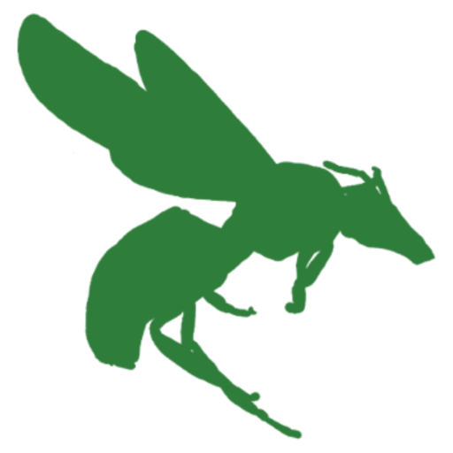

```{=html}
<style>#title-block-header { display: none; }</style>
```

:::: {.home-hero .column-screen}

```{=html}
<div class="home-photo" role="img"
     aria-label="A female long-horned bee looking out from her nest burrow in the soil"
     style="background-image: url('images/hero.jpg'); background-position: 50% 50%;"></div>
```

::: {.home-text}

```{=html}
<h1 class="home-title"><span class="lab-name">Ostwald Wild Bee Lab </span> Behaviour and social ecology in a warming world</h1>
```

We study how wild bees respond to a warming climate. Our work combines fieldwork at bee nests with computational work on large image datasets, where we track how bee traits change across space and time.

We're based in the Centre for Biodiversity and Sustainability at Queen Mary University of London. [Read more about our research](research.qmd).

[*Eucera longicornis*. Photo: Penny Frith]{.home-credit}
:::

::::

## News

::: {#recent-news}
:::

[All news](news.qmd)
