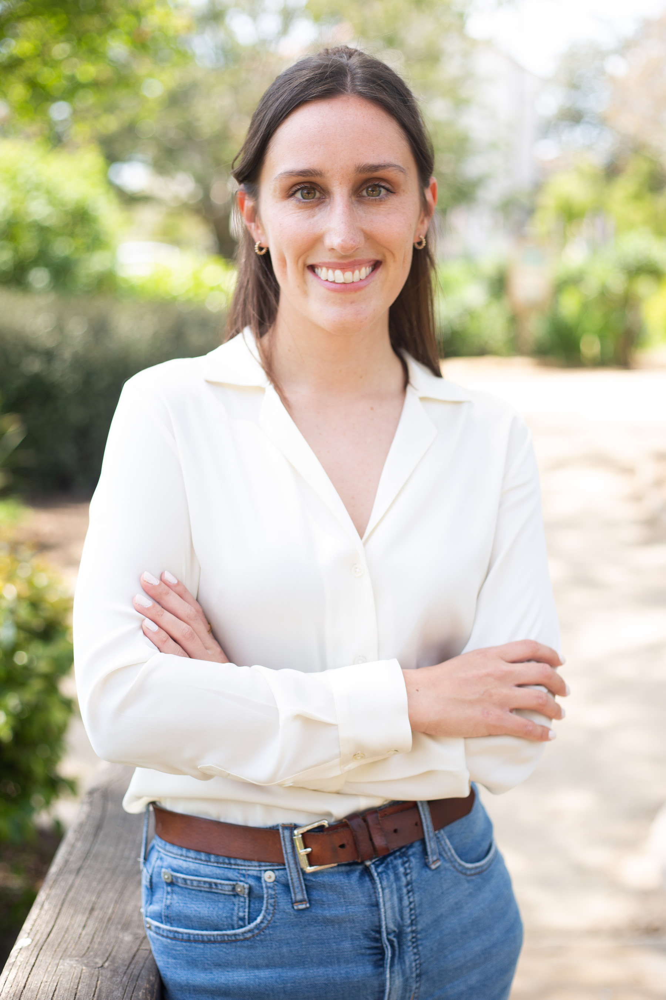
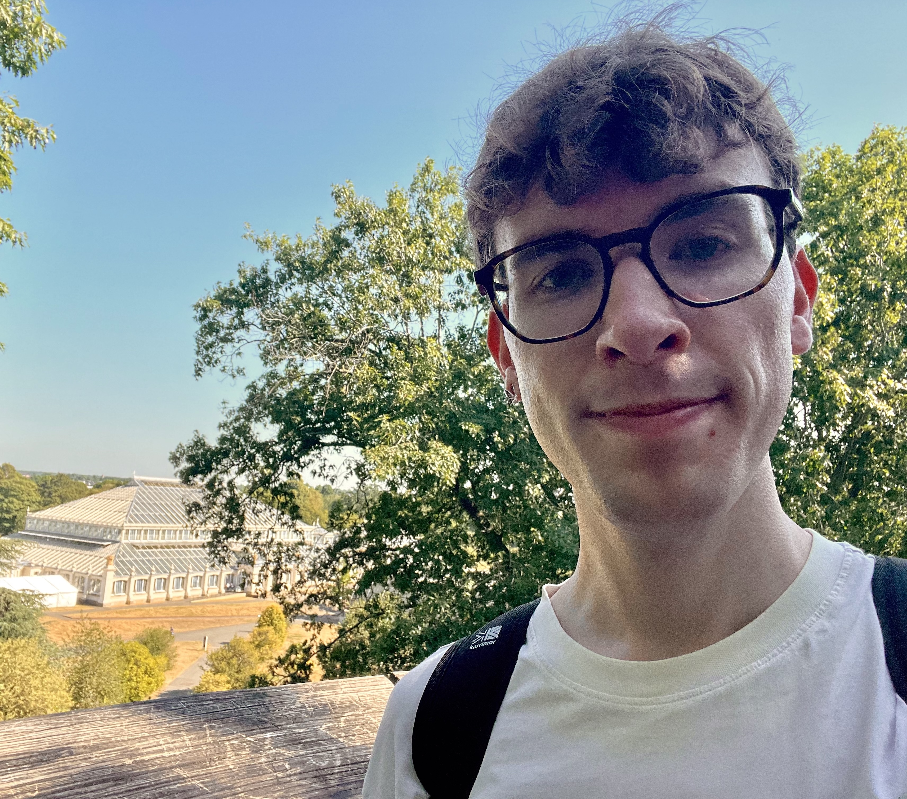
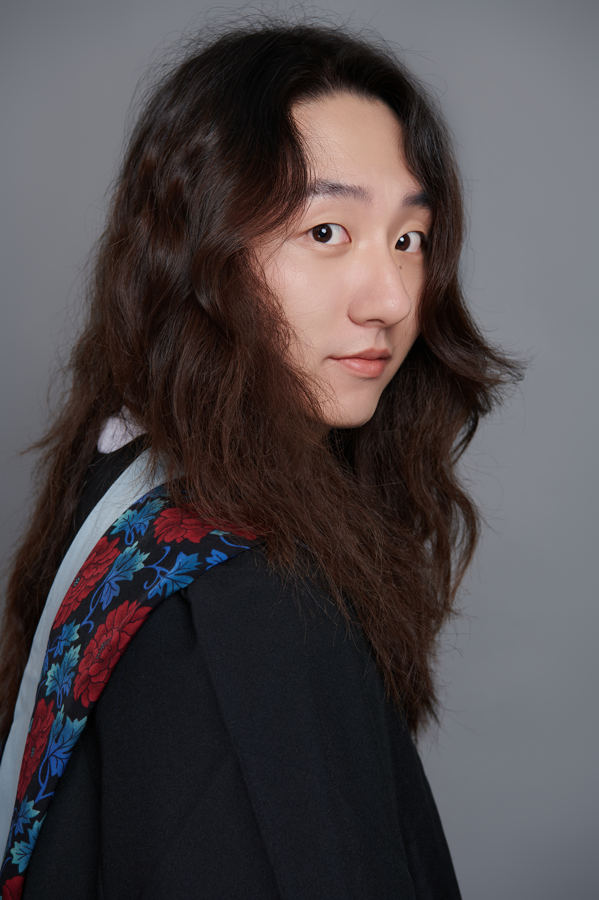

<!--
Each person is one block like the ones below: copy a whole block from ::: {.person} to its closing :::
Photos go in the images folder; square-ish photos at least 400 pixels wide work best.
Until you have a photo, keep images/person-placeholder.svg.
-->

::: {.person}
::: {.person-photo}
{fig-alt="Photo of Madeleine Ostwald" style="object-position: 50% 0%;"}
:::
::: {.person-text}
::: {.person-name}
Madeleine Ostwald
:::
::: {.person-role}
Principal investigator
:::
I am a behavioural ecologist interested in the strategies animals use to cope with environmental pressures, especially by shifting their behaviour or cooperating with others. I have studied bees everywhere from deserts to tropical forests; I now focus on urban species and how cities provide both refuges and challenges for these important pollinators. 
:::
:::

## PhD students

::: {.person}
::: {.person-photo}
{fig-alt="Photo of Matthew Lawrence"}
:::
::: {.person-text}
::: {.person-name}
Matthew Lawrence
:::
::: {.person-role}
PhD student (2026–)
:::
Matthew is interested in the behaviour and ecology of wild bees in response to climate change. Previously, he completed his Zoology BSc (2022) and MSc Biological Sciences by Research (2024) at Royal Holloway, University of London, where he investigated the social dynamics of homing pigeons. He then went onto volunteer at the RSPB Exe Estuary Reserves where he gained experience in the management of grazing marsh habitat to help increase breeding numbers of ground-nesting birds. Following this experience, he worked as a graduate ecologist at an environmental consultancy, where he completed preliminary ecological appraisals and surveys for a range of protected species such as bats, reptiles, and breeding birds, before joining the lab group as a PhD student at Queen Mary University of London under the supervision of Madeleine Ostwald (QMUL), Rachel Parkinson (QMUL), Paul Hurd (QMUL), and Elli Leadbeater (UCL). 
:::
:::

::: {.person}
::: {.person-photo}
{fig-alt="Photo of Dexian Wang"}
:::
::: {.person-text}
::: {.person-name}
Dexian Wang
:::
::: {.person-role}
PhD student (2026–)
:::
Dexian is interested in how bees respond to global change, particularly across species and scales.
:::
:::

## Lab alumni

<!-- One line per person, most recent first. Copy and edit the line. -->
- **Mayu Seguchi**, MSc student (2025–2026). Dissertation: Diel activity of the solitary, ground-nesting bee *Eucera longicornis* redistributes in response to a record-breaking heatwave in England.
