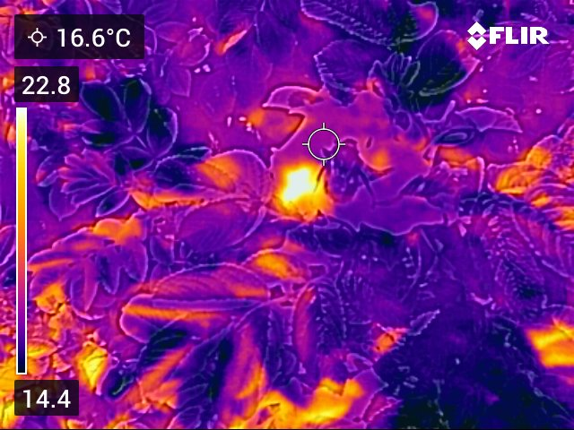
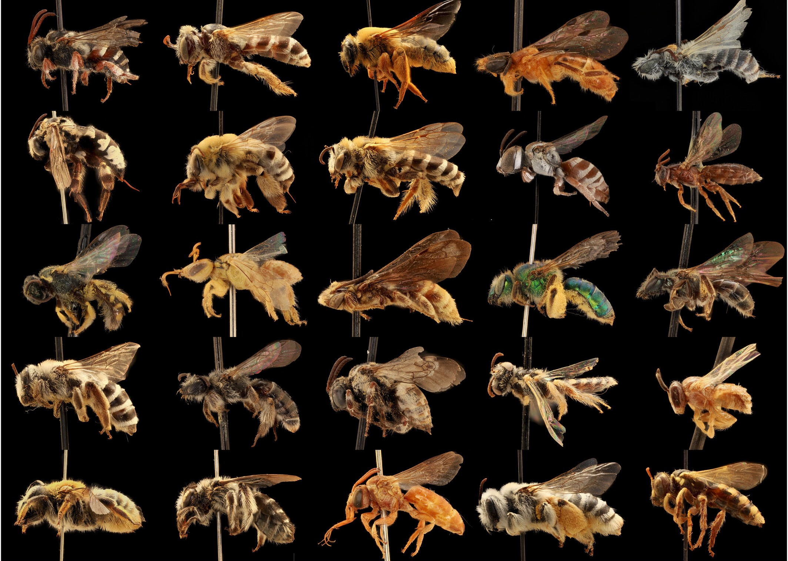
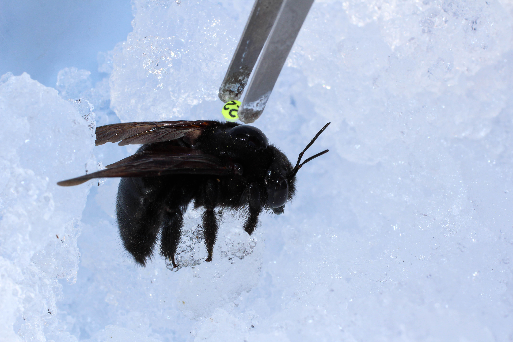

<!-- Edit the headings and paragraphs freely. Each photo block sits directly under its heading.
     Swap the file names for your own photos in the images folder. -->

## Stress and resilience under warming {#heat}

::: {.research-photo}

:::

We investigate how wild bees are coping with rising temperatures. We track their responses to real heat stress in the wild to understand how they buffer against extreme heat and how close to their thermal limits they are. We're particularly interested in how bees' nests can be both refuges and heat traps. Ultimately, we aim to use these insights to design more climate-resilient habitat for vulnerable species.

## Macroecology of functional traits {#macroecology}

::: {.research-photo .left}

:::

Bees vary enormously in size, shape, and colour, and these traits shape how they handle heat, carry pollen, and move through landscapes. Using large image datasets and computational tools such as deep learning, we measure these functional traits across diverse bee species. We use these data to understand how trait diversity allows bees to thrive in diverse climates across the globe.

## Ecology of social living {#social}

::: {.research-photo}

:::

Bees are among the most socially diverse animal groups. We are interested in the many bee species that are flexibly social--solitary in some conditions, social in others. We study their behaviour under different environmental conditions to understand how the environment shapes social behaviour, and to predict how climate warming might shift the costs and benefits of social life.
